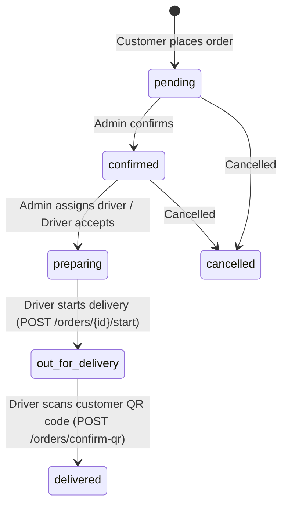

# Mostafa Salama — Flutter Delivery Driver API Documentation

This document describes the complete REST API contract for the **Mostafa Salama Delivery Management System** tailored for the Flutter mobile application.

- **Base URL (Production):** `https://mostafasalama.com`
- **Base URL (Local Development):** `http://127.0.0.1:8000` (or your local IP for mobile devices/emulators: `http://10.0.2.2:8000` on Android emulator)
- **API Prefix:** `/api/delivery`
- **Authentication Scheme:** `Bearer Token` via **Laravel Sanctum**
- **Default Headers:**
  ```http
  Accept: application/json
  Content-Type: application/json
  ```

---

## Table of Contents

1. [Authentication & Authorization Overview](#1-authentication--authorization-overview)
2. [Order Status Workflow](#2-order-status-workflow)
3. [Error Handling & Standard Error Codes](#3-error-handling--standard-error-codes)
4. [API Endpoints](#4-api-endpoints)
   - [4.1 POST /api/delivery/login](#41-post-apideliverylogin)
   - [4.2 POST /api/delivery/logout](#42-post-apideliverylogout)
   - [4.3 GET /api/delivery/me](#43-get-apideliveryme)
   - [4.4 POST /api/delivery/change-password](#44-post-apideliverychange-password)
   - [4.5 GET /api/delivery/orders](#45-get-apideliveryorders)
   - [4.6 GET /api/delivery/orders/{id}](#46-get-apideliveryordersid)
   - [4.7 POST /api/delivery/orders/{id}/accept](#47-post-apideliveryordersidaccept)
   - [4.8 POST /api/delivery/orders/{id}/start](#48-post-apideliveryordersidstart)
   - [4.9 POST /api/delivery/orders/confirm-qr](#49-post-apideliveryordersconfirm-qr)
5. [Flutter / Dart Implementation Examples](#5-flutter--dart-implementation-examples)

---

## 1. Authentication & Authorization Overview

1. Delivery driver accounts are created by restaurant administrators via the Admin Dashboard (`/admin/delivery`).
2. Login credentials are:
   - **Username:** Driver's registered email address (e.g. `driver@mostafasalama.com`).
   - **Password:** Provided or auto-generated by the admin.
3. If an account has `must_change_password: true`, the Flutter app should prompt the driver to choose a new password upon first login using the `POST /api/delivery/change-password` endpoint.
4. All authenticated endpoints require the header:
   ```http
   Authorization: Bearer <sanctum_token>
   ```
5. If the driver's account is deactivated by an administrator, any incoming API request immediately revokes the token and returns `403 Forbidden` (`ACCOUNT_DEACTIVATED`).
6. Delivery drivers have zero access to administrative web routes (`/admin/*`), ensuring complete role isolation.

---

## 2. Order Status Workflow

Orders in Mostafa Salama follow a structured lifecycle:



### Order Status Enum Values
| Status Value | Meaning | Description |
| :--- | :--- | :--- |
| `pending` | قيد الانتظار | Order received from customer, awaiting kitchen confirmation. |
| `confirmed` | مؤكد | Order confirmed by admin. |
| `preparing` | جاري التجهيز | Kitchen is preparing order / Driver assigned or accepted. |
| `out_for_delivery` | جاري التوصيل | Driver has departed restaurant with the food. |
| `delivered` | تم التسليم | Delivery successfully confirmed via customer QR code scan. |
| `cancelled` | ملغي | Order cancelled by customer (pending only) or admin. |

---

## 3. Error Handling & Standard Error Codes

All error responses return standard JSON format:
```json
{
  "success": false,
  "message": "Human readable error description",
  "error_code": "ERROR_CODE_IDENTIFIER"
}
```

### Standard Error Codes
| Error Code | HTTP Status | Meaning |
| :--- | :--- | :--- |
| `UNAUTHENTICATED` | 401 | Missing or invalid Bearer token. |
| `INVALID_CREDENTIALS` | 401 | Incorrect email or password. |
| `NOT_A_DRIVER` | 403 | Authenticated user is not registered as a delivery driver. |
| `ACCOUNT_DEACTIVATED` | 403 | Driver account is deactivated by admin. |
| `FORBIDDEN` | 403 | Attempting to access an order assigned to a different driver. |
| `NOT_FOUND` | 404 | Order or resource does not exist. |
| `INVALID_TOKEN` | 404 / 422 | QR code token signature is invalid, forged, or unreadable. |
| `INVALID_STATUS` | 400 | Order cannot transition from its current status (e.g. starting a cancelled order). |
| `UNASSIGNED_DRIVER` | 403 | QR code belongs to an order assigned to another driver. |
| `ALREADY_DELIVERED` | 409 | QR code scan rejected because order has already been marked as delivered. |
| `VALIDATION_ERROR` | 422 | Input parameters failed validation. |

---

## 4. API Endpoints

### 4.1 POST `/api/delivery/login`
Authenticate the driver and issue a Bearer token.

- **Auth:** Public
- **Rate Limit:** 10 attempts per minute

#### Request Body
```json
{
  "email": "driver@mostafasalama.com",
  "password": "Password123!",
  "device_name": "Google Pixel 8"
}
```

#### Success Response (`200 OK`)
```json
{
  "success": true,
  "message": "Login successful",
  "data": {
    "token": "1|qX8zP19uKLQ2m5vWc7dY0pReT3...",
    "token_type": "Bearer",
    "must_change_password": false,
    "driver": {
      "id": 5,
      "name": "Ahmed Mahmoud",
      "email": "driver@mostafasalama.com",
      "phone": "01012345678",
      "role": "delivery",
      "is_active": true
    }
  }
}
```

---

### 4.2 POST `/api/delivery/logout`
Revoke the current access token.

- **Auth:** `Bearer Token`

#### Success Response (`200 OK`)
```json
{
  "success": true,
  "message": "Logged out successfully"
}
```

---

### 4.3 GET `/api/delivery/me`
Retrieve authenticated driver profile and live operational stats.

- **Auth:** `Bearer Token`

#### Success Response (`200 OK`)
```json
{
  "success": true,
  "data": {
    "driver": {
      "id": 5,
      "name": "Ahmed Mahmoud",
      "email": "driver@mostafasalama.com",
      "phone": "01012345678",
      "role": "delivery",
      "is_active": true,
      "must_change_password": false,
      "created_at": "2026-11-08T18:00:00.000000Z"
    },
    "stats": {
      "active_orders": 2,
      "completed_today": 8,
      "total_completed": 142
    }
  }
}
```

---

### 4.4 POST `/api/delivery/change-password`
Change driver password. If `must_change_password` is `true`, `current_password` is optional.

- **Auth:** `Bearer Token`

#### Request Body
```json
{
  "current_password": "OldTemporaryPass123",
  "new_password": "NewPermanentPass456!",
  "new_password_confirmation": "NewPermanentPass456!"
}
```

#### Success Response (`200 OK`)
```json
{
  "success": true,
  "message": "Password updated successfully."
}
```

---

### 4.5 GET `/api/delivery/orders`
Retrieve paginated list of orders assigned to the authenticated driver.

- **Auth:** `Bearer Token`
- **Query Parameters:**
  - `status` (optional):
    - `active` *(default)*: Returns orders currently in progress (`pending`, `confirmed`, `preparing`, `out_for_delivery`).
    - `completed`: Returns orders marked as `delivered`.
    - `all`: Returns all assigned orders.
    - Or specific status name (e.g. `out_for_delivery`).
  - `page` (optional, integer, default: `1`).
  - `per_page` (optional, integer, default: `15`, max: `50`).

#### Request Example
```http
GET /api/delivery/orders?status=active&page=1 HTTP/1.1
Authorization: Bearer <sanctum_token>
```

#### Success Response (`200 OK`)
```json
{
  "success": true,
  "data": {
    "orders": [
      {
        "id": 42,
        "order_number": "ORD-672DE1F2",
        "status": "out_for_delivery",
        "total": 245.0,
        "delivery_fee": 20.0,
        "customer": {
          "name": "Mohamed Ali",
          "phone": "01234567890",
          "address": "15 Abbas El Akkad St, Nasr City, Floor 3, Apt 12"
        },
        "notes": "Please do not ring bell, baby is sleeping",
        "items_count": 3,
        "assigned_at": "2026-11-08T18:15:00.000000Z",
        "driver_accepted_at": "2026-11-08T18:16:30.000000Z",
        "delivered_at": null,
        "created_at": "2026-11-08T18:05:00.000000Z"
      }
    ],
    "pagination": {
      "current_page": 1,
      "last_page": 1,
      "per_page": 15,
      "total": 1,
      "has_more": false
    }
  }
}
```

---

### 4.6 GET `/api/delivery/orders/{id}`
Retrieve full details of an assigned order.

- **Auth:** `Bearer Token`
- **Rule:** The driver can ONLY access orders assigned to their account. If accessed by another driver, `403 Forbidden` is returned.

#### Success Response (`200 OK`)
```json
{
  "success": true,
  "data": {
    "order": {
      "id": 42,
      "order_number": "ORD-672DE1F2",
      "status": "out_for_delivery",
      "total": 245.0,
      "delivery_fee": 20.0,
      "subtotal": 225.0,
      "customer": {
        "id": 18,
        "name": "Mohamed Ali",
        "phone": "01234567890",
        "email": "customer@example.com",
        "delivery_address": "15 Abbas El Akkad St, Nasr City, Floor 3, Apt 12"
      },
      "notes": "Please do not ring bell, baby is sleeping",
      "items": [
        {
          "id": 81,
          "product_id": 4,
          "name": "كشري سوبر مصطفى سلامة",
          "price": 75.0,
          "quantity": 2,
          "subtotal": 150.0,
          "bundle": null
        },
        {
          "id": 82,
          "product_id": 9,
          "name": "طاجن مكرونة باللحمة",
          "price": 75.0,
          "quantity": 1,
          "subtotal": 75.0,
          "bundle": null
        }
      ],
      "assigned_at": "2026-11-08T18:15:00.000000Z",
      "driver_accepted_at": "2026-11-08T18:16:30.000000Z",
      "delivered_at": null,
      "created_at": "2026-11-08T18:05:00.000000Z",
      "updated_at": "2026-11-08T18:20:00.000000Z"
    }
  }
}
```

---

### 4.7 POST `/api/delivery/orders/{id}/accept`
Driver acknowledges and accepts order assignment. Advances status from `pending`/`confirmed` to `preparing`.

- **Auth:** `Bearer Token`

#### Success Response (`200 OK`)
```json
{
  "success": true,
  "message": "Order accepted successfully.",
  "data": {
    "order": { ... }
  }
}
```

---

### 4.8 POST `/api/delivery/orders/{id}/start`
Driver departs with the order. Updates status to `out_for_delivery` and sends real-time in-app/push notifications to the customer.

- **Auth:** `Bearer Token`

#### Success Response (`200 OK`)
```json
{
  "success": true,
  "message": "Delivery started. Order is now out for delivery.",
  "data": {
    "order": { ... }
  }
}
```

---

### 4.9 POST `/api/delivery/orders/confirm-qr`
Confirm delivery via QR code scan upon reaching customer.

- **Auth:** `Bearer Token`
- **Concurrency & Race Conditions:** Uses database transactions with pessimistic row locking (`lockForUpdate()`) to strictly prevent duplicate scans.
- **Accepted Token Shapes:**
  - Raw HMAC delivery token: `42-a8b3c9d7e1f4...`
  - Or full URL scanned from customer's screen: `https://mostafasalama.com/delivery/confirm/42-a8b3c9d7e1f4...`

#### Request Body
```json
{
  "qr_token": "42-a8b3c9d7e1f42805cb798031d2be19ec",
  "order_id": 42
}
```
*(Note: `order_id` is optional; if provided, backend double-verifies that the scanned QR token belongs to this exact order).*

#### Success Response (`200 OK`)
```json
{
  "success": true,
  "message": "Order marked as delivered successfully! 🎉",
  "data": {
    "order": {
      "id": 42,
      "order_number": "ORD-672DE1F2",
      "status": "delivered",
      "total": 245.0,
      "delivery_fee": 20.0,
      "delivered_at": "2026-11-08T18:42:15.000000Z",
      ...
    },
    "delivery_confirmation": {
      "confirmed_at": "2026-11-08T18:42:15.000000Z",
      "driver_id": 5,
      "driver_name": "Ahmed Mahmoud"
    }
  }
}
```

#### Duplicate Scan Response (`409 Conflict`)
```json
{
  "success": false,
  "message": "This order has already been confirmed as delivered.",
  "error_code": "ALREADY_DELIVERED",
  "delivered_at": "2026-11-08T18:42:15.000000Z"
}
```

#### Unauthorized Driver Scan Response (`403 Forbidden`)
```json
{
  "success": false,
  "message": "Unauthorized. This order is not assigned to you.",
  "error_code": "UNASSIGNED_DRIVER"
}
```

---

## 5. Flutter / Dart Implementation Examples

### 5.1 Service Client (Dio Example)

```dart
import 'package:dio/dio.dart';

class DeliveryApiService {
  final Dio _dio = Dio(
    BaseOptions(
      baseUrl: 'https://mostafasalama.com/api/delivery',
      headers: {
        'Accept': 'application/json',
        'Content-Type': 'application/json',
      },
      connectTimeout: const Duration(seconds: 10),
      receiveTimeout: const Duration(seconds: 15),
    ),
  );

  void setAuthToken(String token) {
    _dio.options.headers['Authorization'] = 'Bearer $token';
  }

  void clearAuthToken() {
    _dio.options.headers.remove('Authorization');
  }

  // 1. Login
  Future<Map<String, dynamic>> login(String email, String password) async {
    final response = await _dio.post('/login', data: {
      'email': email,
      'password': password,
      'device_name': 'Flutter Mobile',
    });
    return response.data;
  }

  // 2. Fetch Assigned Orders
  Future<Map<String, dynamic>> getAssignedOrders({String status = 'active', int page = 1}) async {
    final response = await _dio.get('/orders', queryParameters: {
      'status': status,
      'page': page,
    });
    return response.data;
  }

  // 3. Start Delivery Trip
  Future<Map<String, dynamic>> startDelivery(int orderId) async {
    final response = await _dio.post('/orders/$orderId/start');
    return response.data;
  }

  // 4. Confirm Delivery via QR Code Scan
  Future<Map<String, dynamic>> confirmQrDelivery(String scannedCode, {int? orderId}) async {
    final response = await _dio.post('/orders/confirm-qr', data: {
      'qr_token': scannedCode,
      if (orderId != null) 'order_id': orderId,
    });
    return response.data;
  }
}
```

### 5.2 QR Scanner Integration (mobile_scanner)

```dart
import 'package:flutter/material.dart';
import 'package:mobile_scanner/mobile_scanner.dart';

class QrScannerScreen extends StatefulWidget {
  final int orderId;
  final DeliveryApiService apiService;

  const QrScannerScreen({Key? key, required this.orderId, required this.apiService}) : super(key: key);

  @override
  State<QrScannerScreen> createState() => _QrScannerScreenState();
}

class _QrScannerScreenState extends State<QrScannerScreen> {
  bool _isProcessing = false;

  void _onDetect(BarcodeCapture capture) async {
    if (_isProcessing) return;
    final List<Barcode> barcodes = capture.barcodes;
    if (barcodes.isEmpty) return;

    final String? scannedValue = barcodes.first.rawValue;
    if (scannedValue == null || scannedValue.isEmpty) return;

    setState(() => _isProcessing = true);

    try {
      final result = await widget.apiService.confirmQrDelivery(
        scannedValue,
        orderId: widget.orderId,
      );

      if (mounted) {
        ScaffoldMessenger.of(context).showSnackBar(
          const SnackBar(
            content: Text('🎉 تم تأكيد تسليم الطلب بنجاح!'),
            backgroundColor: Colors.green,
          ),
        );
        Navigator.pop(context, true);
      }
    } on DioException catch (e) {
      final errorMsg = e.response?.data['message'] ?? 'فشل تأكيد الاستلام، يرجى المحاولة مرة أخرى.';
      if (mounted) {
        ScaffoldMessenger.of(context).showSnackBar(
          SnackBar(content: Text('⚠️ $errorMsg'), backgroundColor: Colors.red),
        );
      }
    } finally {
      if (mounted) {
        setState(() => _isProcessing = false);
      }
    }
  }

  @override
  Widget build(BuildContext context) {
    return Scaffold(
      appBar: AppBar(title: const Text('مسح رمز QR للعميل')),
      body: Stack(
        children: [
          MobileScanner(onDetect: _onDetect),
          if (_isProcessing)
            const Center(child: CircularProgressIndicator(color: Color(0xFFF5A900))),
        ],
      ),
    );
  }
}
```
